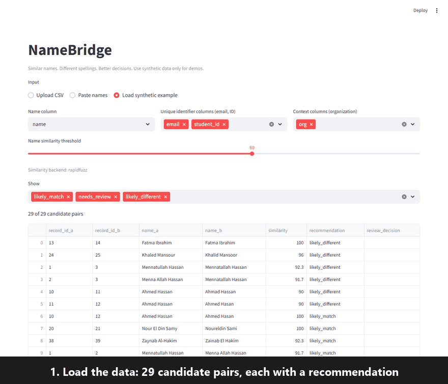
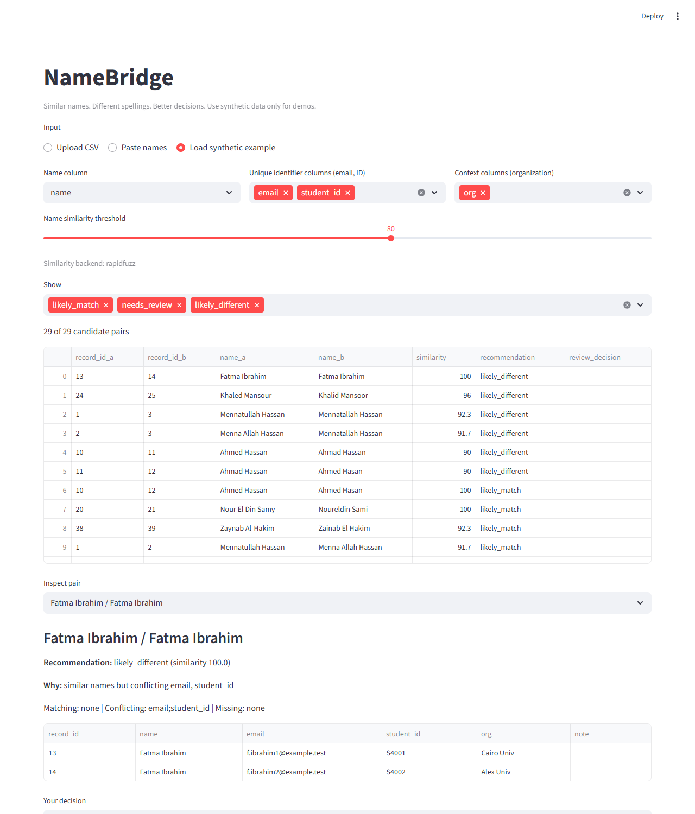
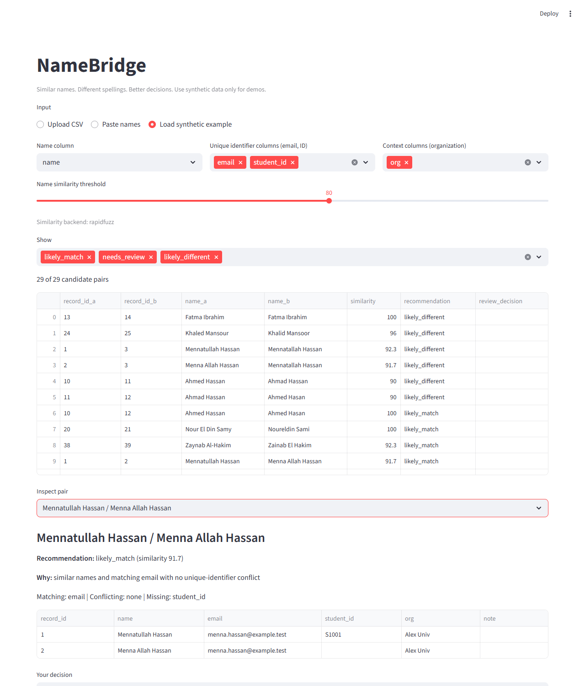
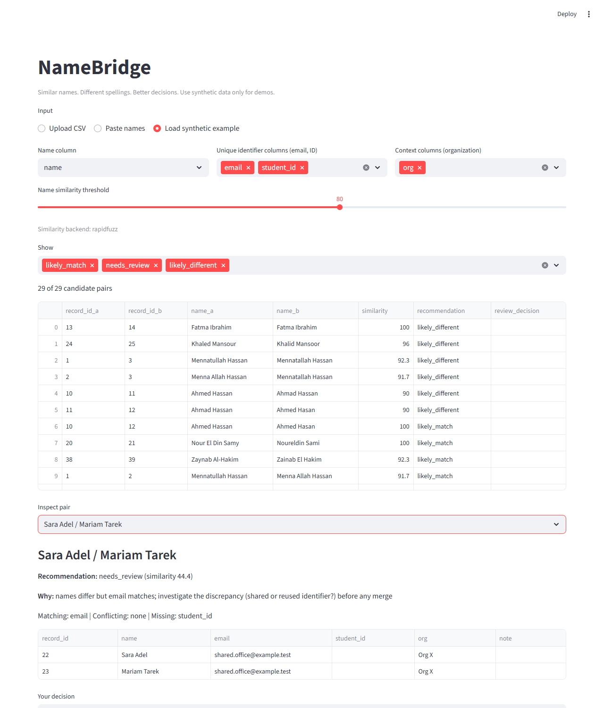
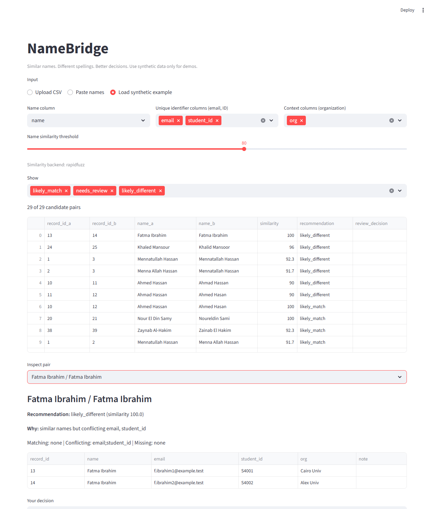
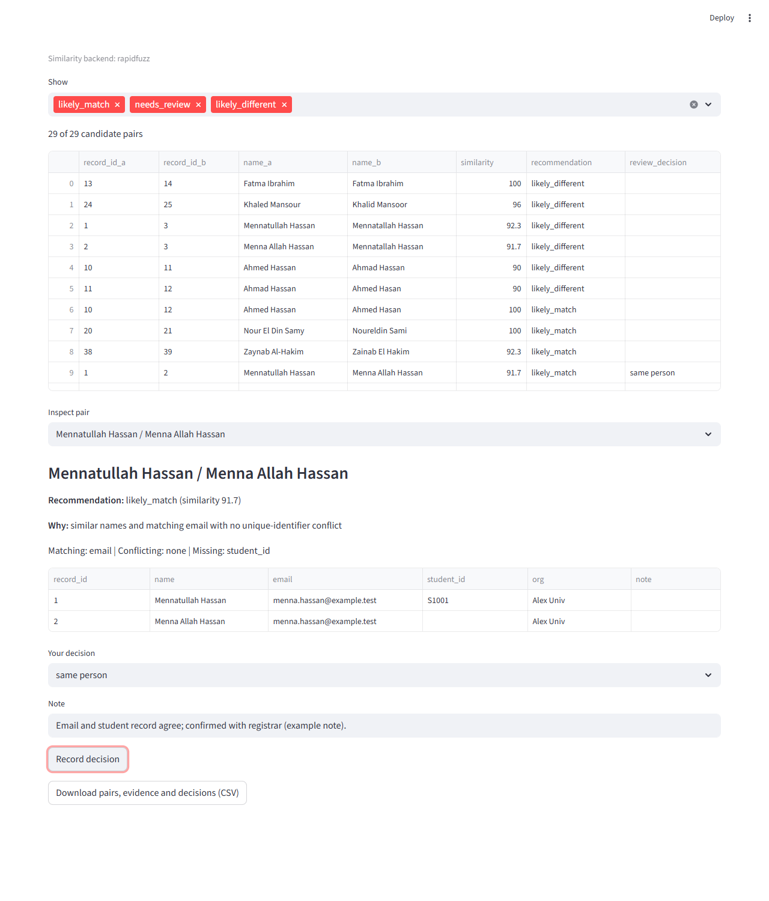

# NameBridge

**Similar names. Different spellings. Better decisions.**
A human-in-the-loop tool for reviewing possible duplicate records that contain Arabic names written in Latin script. It recommends, shows its evidence, and says "needs review" when it does not know. **It never merges or deletes anything.**

[docs_walkthrough.webm](https://github.com/user-attachments/assets/afea0123-e20a-44ec-ab28-34a62543b648)




## See it working
| | |
|---|---|
| **Short video (68 s, captioned)** | Plays at the top of this page. The file is also in the repository: [docs/walkthrough.webm](docs/walkthrough.webm) ([direct link](https://github.com/MennaElnashar/Name-Bridge/raw/main/docs/walkthrough.webm)). |
| **Step-by-step walkthrough with screenshots** | [docs/walkthrough.md](docs/walkthrough.md) |
| **Run it yourself** | `pip install -r requirements.txt`, then `streamlit run app.py` (see [Quick start](#quick-start)) |

| Candidate pairs | Likely match | Needs review (shared mailbox) |
|---|---|---|
| [](docs/img/01_candidate_pairs.png) | [](docs/img/02_likely_match.png) | [](docs/img/03_shared_mailbox_needs_review.png) |

| Likely different (identical names) | Decision recorded |
|---|---|
| [](docs/img/04_identical_names_likely_different.png) | [](docs/img/05_decision_recorded.png) |

## The problem
I faced this myself: local organizations each wrote my name, "Mennatullah", in a different way. That is not carelessness. Arabic has sounds that Latin letters do not map to one by one, so every writer chooses their own transliteration, and a name also gets split or joined differently:

| One person, several spellings | Why they differ |
|---|---|
| Mohamed, Muhammad, Mohammed, Mo | vowel choice, doubled letters, a nickname |
| Abdelrahman, Abd El Rahman, Abdul Rahman | one word, three words, or a different article |
| Mennatullah, Menna Allah, Mennatallah | spacing and vowels |
| Ahmed El Sayed, Ahmed Al-Sayed, Ahmad Elsayed | the article "El/Al", a hyphen, a vowel |

Any system that holds records of people, such as registrations, student lists, member lists or a CRM, then fails in two opposite ways:

1. **It misses duplicates.** Exact matching cannot see that "Mohamed Ali" and "Muhammad Aly" are one person, so counts are inflated and one person receives several messages, certificates or accounts.
2. **It merges different people.** A fuzzy match scores "Ahmed Hassan" and "Ahmad Hassan" as 90% alike and a tool or a hurried person merges them, but they can be two people. A wrong merge is worse than a missed duplicate: it can destroy one person's data or show it to someone else.

The usual answer is a similarity score and a threshold. That answers "are these two *spellings* alike?", not "are these two *records* the same person?". Two people can share a name exactly (two "Fatma Ibrahim" records with different emails), and one person can have spellings that look very different. A score hides this uncertainty and turns it into a confident-looking number.

The people who deal with this, such as administrators, organizers and analysts, usually sort a spreadsheet by name and eyeball it, or run a fuzzy match and trust it. NameBridge replaces that with a workflow: **see candidate pairs, see the evidence behind each, record your own decision, export everything.** The aim is not a cleverer score; it is an honest recommendation that states how much evidence it has, and defaults to "needs review" when the evidence does not decide.

**Not in scope:** automatic merging or deletion, verifying legal identity, training a model, covering every dialect and transliteration, production scale, or real personal records in a demo. Details and the hypotheses I set before building are in [intent.md](intent.md).

## How it works
Three separate questions, never mixed up:

1. **Are the spellings alike enough to look at?** Name similarity (RapidFuzz) after a separate normalized form; the original spelling is never changed and is exported byte for byte. This only generates *candidates*.
2. **Is there evidence the records are the same person?** Identifiers are compared on their own: unique ones (email, student ID) and, weakly, context (organization). Free-text notes, including claims like "confirmed same person", are never evidence.
3. **Is that evidence strong enough to recommend?** A written policy ([src/policy.py](src/policy.py)) gives one of three answers, and any doubt gives "needs review":

| Situation | Recommendation |
|---|---|
| Similar names, a unique identifier matches, none conflict | `likely_match` |
| Similar names, a unique identifier conflicts, none match | `likely_different` |
| One identifier matches while another conflicts | `needs_review` (people can share one and not the other) |
| Similar names, no identifier evidence either way | `needs_review` |
| Different names but a unique identifier matches | `needs_review` (shared or reused identifier? never silently merge) |
| Organization differs only | reported, never decisive |
| Anything else | `needs_review` |

You then record "same person", "different people" or "unsure" for each pair, with a note, and export pairs, evidence, scores and decisions as CSV. An **optional** local-model layer can explain a pair, but its output is discarded if it is malformed, invents an identifier, or tries to upgrade the recommendation ([src/llm_review.py](src/llm_review.py)). The app and every test work with no model.

## Results at a glance
All results are on synthetic data and are reproducible with the commands below. Full tables and caveats: [docs/evaluation_protocol.md](docs/evaluation_protocol.md).

| Test | Result |
|---|---|
| First set: 42 records, 29 hand-labelled pairs | Name-only rule: 2 of 29 agree, **8 false merges**. Final policy: 29 of 29, **0 false merges** |
| Stress 1: 120 different people (7,140 pairs) and a threshold sweep | The fix only works in a narrow band (29 of 29 at similarity 75 to 80, 26 at 85, 24 at 90); review workload rises from 37 to 49 flagged pairs |
| Stress 2, hard set: 36 records, 21 pairs (Arabic script, diacritics, nickname, `ibn`/`bin`, dropped "Al", reused IDs, a misleading note) | Policy: 21 of 21 labelled pairs agree but **1 false merge** (two different people sharing a student ID). Name-only: 7 of 21, 10 false merges |
| Small local model (Qwen2.5-0.5B-Instruct, CPU, one run, 58 pairs) | The checker rejected 57 of 58 outputs and let no upgrade through. Shown only two names, the model said "same" for 6 of 27 pairs of different people |
| Blind second labelling pass by the project owner (24 pairs) | 20 of 24 answers agree with the policy; all 14 firm policy calls agreed, including the shared-ID mistake. Not independent |

The honest headline: **identifiers, not similarity scores, did the safety work, and one matching identifier is strong evidence but not proof.** What I unlearned along the way is in [docs/writeup.md](docs/writeup.md).

## Quick start
Developed and tested on Python 3.13 (Windows). It runs offline.
```
pip install -r requirements.txt
streamlit run app.py                         # the app, http://localhost:8501; choose "Load synthetic example"
python -m unittest discover -s tests -t .    # 46 tests (or: pytest)
python -m src.evaluate                       # evaluation on both data sets -> outputs/
python -m src.stress                         # threshold sweep and homonym stress test -> outputs/
python -m src.labelling make                 # blind labelling sheet -> labelling/ (see labelling/README.md)
python -m src.compare_models <model folder>  # optional model comparison (needs transformers and torch)
```
Use [data/synthetic_names.csv](data/synthetic_names.csv) for demos. Do not upload real personal records to a public demo.

### Using your own CSV
In the app choose **Upload CSV** (or **Paste names**, one per line). Pick the name column, the *unique identifier* columns (for example email, student ID) and optional *context* columns (for example organization). Rows with a `record_id` column keep it; otherwise rows are numbered. The prototype compares every pair, so it is limited to 2,000 rows. The export has these columns: `record_id_a, record_id_b, name_a, name_b, similarity, recommendation, reason, matching_ids, conflicting_ids, missing_ids, soft_conflicts, review_decision, reviewer_note`.

## Repository map
```
NameBridge/
├── README.md              you are here
├── intent.md              day-one contract: problem, scope, hypotheses, success criteria
├── Final directive.md     operating rules for the tool and for any AI assistant working on it
├── app.py                 the Streamlit app
├── requirements.txt       dependencies (model packages are optional and commented out)
├── src/                   the code
├── tests/                 46 unit tests
├── data/                  synthetic records and hand-written gold labels
├── outputs/               result files from the evaluations, stress tests and model run
├── docs/                  write-up, AI usage log, evaluation protocol, retrospective, walkthrough
└── labelling/             blind labelling sheet, answer key and the owner's completed pass
```

**[src/](src)**
| File | What it does |
|---|---|
| [normalization.py](src/normalization.py) | Two normalized forms used only for matching (conservative, aggressive); the original name is never modified |
| [matching.py](src/matching.py) | Name similarity (RapidFuzz, with a pure-Python fallback) and pair generation |
| [evidence.py](src/evidence.py) | Compares identifiers; never looks at spelling or free-text notes |
| [policy.py](src/policy.py) | The decision rules above |
| [pipeline.py](src/pipeline.py) | CSV in, candidate pairs out; reads values exactly as written |
| [llm_review.py](src/llm_review.py) | Optional model layer and the checker that rejects bad model output |
| [evaluate.py](src/evaluate.py), [stress.py](src/stress.py) | Reproducible evaluation and stress tests |
| [compare_models.py](src/compare_models.py) | Model-versus-policy comparison, local or hosted |
| [labelling.py](src/labelling.py) | Builds and scores the blind labelling sheet |

**[tests/](tests)** `test_matching.py` (17), `test_llm_review.py` (10), `test_normalization.py` (6), `test_labelling.py` (6), `test_gold_labels.py` (3), `test_remote_generator.py` (3), `test_compare_models.py` (1). Details of each folder: [data/](data/README.md), [outputs/](outputs/README.md), [docs/](docs/README.md), [labelling/](labelling/README.md).

## Documents: where to read what
| If you want to know | Read |
|---|---|
| What problem, for whom, and what I expected | [intent.md](intent.md) |
| The rules the tool and AI assistants follow | [Final directive.md](Final%20directive.md) |
| The short story: problem, what I unlearned, how I used AI, what failed | [docs/writeup.md](docs/writeup.md) |
| Day-by-day AI use, every prompt, where the AI was wrong | [docs/ai_usage_log.md](docs/ai_usage_log.md) |
| Evidence and numbers, and the limits of that evidence | [docs/evaluation_protocol.md](docs/evaluation_protocol.md) |
| How my understanding changed | [docs/retrospective.md](docs/retrospective.md) |
| A demo with screenshots | [docs/walkthrough.md](docs/walkthrough.md) |
| The plan as it was actually executed | [docs/implementation_plan.md](docs/implementation_plan.md) |

### For reviewers: where each criterion is evidenced
| Criterion | Evidence |
|---|---|
| Problem choice: real, hard, found by me | [intent.md](intent.md) ("How this started"), the problem section above, [docs/writeup.md](docs/writeup.md) |
| Unlearning | [docs/writeup.md](docs/writeup.md) ("What I unlearned"), [docs/retrospective.md](docs/retrospective.md), the before and after snapshots [outputs/eval_before_day4.json](outputs/eval_before_day4.json) and [outputs/eval_results.json](outputs/eval_results.json) |
| AI-native working | [docs/ai_usage_log.md](docs/ai_usage_log.md): four days (13 to 16 October), every prompt, what each tool did and where it was wrong |
| Shipping | This repository, the app, the screenshots and video above, [docs/walkthrough.md](docs/walkthrough.md) |
| Stress growth | "Stress growth" table in [docs/writeup.md](docs/writeup.md); detail in [docs/evaluation_protocol.md](docs/evaluation_protocol.md); raw results in [outputs/](outputs/README.md) |
| Operating rules | [Final directive.md](Final%20directive.md) |

## How AI was used
ChatGPT for brainstorming and the plan (13 Oct); Claude for the first full build (14 Oct); GitHub Copilot in VS Code for running, auditing, fixing, extending, the model run, publishing and packaging (14 to 16 Oct). The work took four calendar days and the log says so. Where the AI overclaimed, such as an app described as finished that had never been launched, the log says that too.

## Status and limits
| Item | State |
|---|---|
| Pipeline, policy, export, app | Built and exercised; 46 tests pass |
| Evaluation, hard set, stress tests | Run with RapidFuzz 3.14.6 |
| Model comparison | One small model (0.5B), one run; says nothing about larger models |
| Gold labels | Written by the same author as the policy; checked by a test against ground truth; one blind pass by the project owner; **nobody outside the project has reviewed them** |
| Known false merge | Two different people sharing one student ID are recommended as a match (hard set pair 115 and 116). A person made the same call; see [docs/retrospective.md](docs/retrospective.md) |
| Not ready for | Real personal records. Synthetic data only, Latin script only |

Privacy: the repository contains only invented data and no credentials. No hosted model is required; the optional hosted mode needs your own token and sends prompts to a third party.
